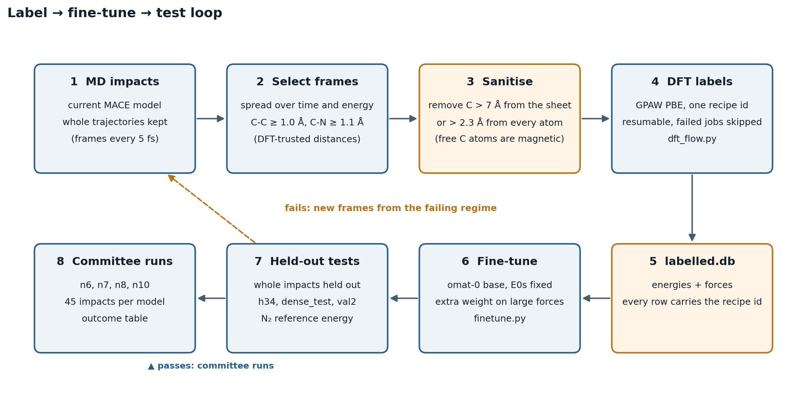
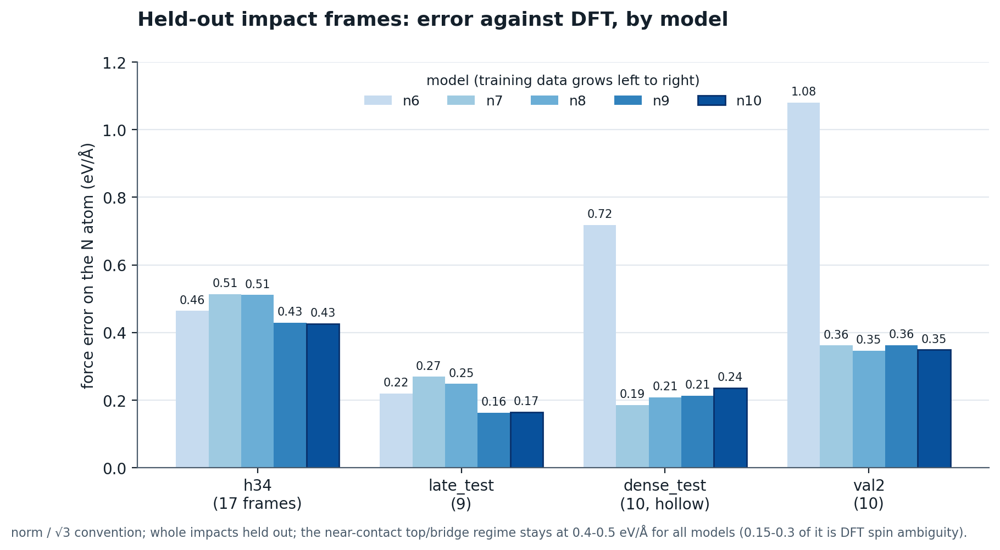

# Graphene_MLIP_Bombardment

Can a fine-tuned machine-learning interatomic potential (MACE) replace AIREBO for ion bombardment of graphene, with DFT as the ground truth?

This repository holds the scripts, the DFT-labelled databases and the result notes of that study. It is a work in progress: stages A to D are done, the limits are listed openly at the end.


## Why

Ion irradiation of graphene (vacancies, doping with N) is usually simulated with classical potentials such as AIREBO. They are fast, but they were fitted near equilibrium. Impacts probe short distances, bond breaking and unusual coordination, which is where classical potentials are least trustworthy. A foundation MLIP fine-tuned on a few hundred DFT frames can be checked against DFT directly. The question is where it helps and where it still fails.

## The four stages

| Stage | Question | Result |
|---|---|---|
| A | Can AIREBO be trusted for defects? | Formation energies of V1, V2, Stone-Wales, adatom and Frenkel pair against GPAW PBE |
| B | Can MACE omat-0 be fine-tuned to DFT labels for C and Ar? | Force error on impact frames 0.42 eV/Å (MACE) against 1.11 eV/Å (AIREBO+ZBL) |
| C | Do paired Ar impacts differ between the two potentials? | Yes: different vacancy thresholds, traced to the C displacement threshold |
| D | Can the model handle N, for which AIREBO has no parameters here? | Tested against DFT on held-out whole impacts; committee of 5 runs per case |

### Stage A: AIREBO against DFT (4×4 cell, eV)

| Defect | AIREBO − DFT |
|---|---|
| Monovacancy V1 | −0.32 |
| Stone-Wales | +0.17 |
| Divacancy V2 | +0.67 |
| C adatom | −2.23 |
| Frenkel pair | +0.93 |

The adatom error holds at 5×5. Stone-Wales in a 5×5 cell shows that AIREBO has two rippled minima (5.81 and 6.02 eV, against 5.54 eV in DFT, which is flat). Repeated seeds and cell heights give the same two values, so the difference is not a cell-size effect.


### Stage B: fine-tuning

- DFT recipe `8c357474ed`: GPAW, PBE, plane waves 450 eV, k-density 5, Fermi-Dirac smearing 0.05 eV, spin-polarised, cell height 20 Å.
- Base model MACE omat-0, fine-tuned on 68 carbon rows and 36 Ar scans, keeping the Ar element.
- Force error on impact frames against DFT: 0.417 eV/Å for the Ar-aware MACE model, 1.107 eV/Å for AIREBO+ZBL.

### Stage C: paired Ar impacts

Same small sheet, same impacts, AIREBO+ZBL against fine-tuned MACE.

- Ar vacancy threshold at the top site: MACE below 50 eV, AIREBO 50 to 55 eV.
- The gap follows the carbon displacement threshold: AIREBO 25 to 26 eV, MACE 20 to 21 eV (experiment-based value about 21 eV).
- A static DFT push scan shows an AIREBO C-C cutoff artefact.
- Frame test (14 DFT frames): force RMSE 1.69 eV/Å (AIREBO) against 0.51 eV/Å (MACE).
- Not proven: the MACE Ar thresholds themselves, because DFT frames do not go below Ar-C 1.6 Å.

### Stage D: nitrogen

AIREBO has no N parameters in this setup, so DFT is the only independent check. The work is an iterative loop: run impacts, label selected frames with DFT, retrain, test on whole impacts that were never in the training set.



Force error on the N atom (eV/Å) on held-out whole impacts:

| Test set | n6 | n7 | n8 | n9 | n10 |
|---|---|---|---|---|---|
| h34 (17 frames) | 0.464 | 0.514 | 0.511 | 0.429 | 0.426 |
| late_test (9) | 0.220 | 0.269 | 0.248 | 0.163 | 0.165 |
| dense_test (10, hollow) | 0.718 | 0.186 | 0.208 | 0.213 | 0.236 |
| val2 (10) | 1.080 | 0.362 | 0.346 | 0.363 | 0.349 |



Outcome of 5 impacts per case with the final model (n10):


- Top site, 20 to 50 eV: N is always bound in-plane, one C atom is ejected. Same in all five models.
- Hollow site, 30 and 50 eV: N is always transmitted. Same in all five models.
- Bridge site, 50 eV: mostly transmitted.
- Bridge site, 20 eV: depends on the model (bound in n6 and n10, reflected in n7 and n8). No probability is quoted.

### Problems found and fixed along the way

- **Magnetic free carbon atoms.** A sputtered C atom in a DFT frame is a free magnetic atom. It makes the SCF oscillate, gives metastable ±4 µB states and failed jobs. Frames are now sanitised: C atoms farther than 7 Å from the sheet, or more than 2.3 Å from every other atom, are removed before labelling.
- **Unstable N₂ reference energy.** With one N₂ row in the training set, the reference energy jumped between retrains. Nine DFT N₂ frames fixed it.


## Limitations

1. Top-site and 50 eV bridge impacts pass through N-C distances below 1.1 Å, the shortest distance labelled by DFT. Forces there are not verified.
2. Labels are spin-polarised and the model does not see spin. This leaves an error of 0.25 to 0.5 eV/Å on near-contact frames, whatever the model.
3. Five runs per case, one set of seeds: outcomes are not probabilities.
4. Formation energies of structures with several N atoms are off by 0.3 to 0.4 eV. Single-N values are within about 0.5 eV (unrelaxed structures).
5. There is no AIREBO comparison for N.
6. The MD sheet was built with a 2.46 Å lattice constant and was not relaxed with AIREBO (about 1.7 % strain compared to the AIREBO value near 2.42 Å). Its effect on the thresholds has not been measured.

## Repository layout

```
stageA_dft_check/       AIREBO against DFT defect energies, result tables (CSV)
stageB_mace_training/   fine-tuning, DFT labelling workflow, impact tests, stage notes
  STAGE_A..D_*.md       detailed result notes
  data/**/labelled*.db  DFT-labelled ASE databases (training and test frames)
figures/                figures and the script that makes them (make_figs.py)
```

The notes `STAGE_A_RESULTS.md` to `STAGE_D_RESULTS.md` hold the full numbers and the reasoning.

## Not included

Model weights, trajectories, logs and the AIREBO potential file are not part of the repository. The fine-tuned model is built on MACE-MP omat-0; check the licence of the base model before redistributing weights.

## Tools

GPAW, ASE, LAMMPS (AIREBO, ZBL), MACE, Python.

## Licence

MIT, see `LICENSE`.

## Author

Safouan Ziat, Ph.D. (GitHub: safouanziat)
