# Replacing AIREBO with a fine-tuned MACE potential for ion bombardment of graphene: a DFT-checked study

Safouan Ziat, Ph.D. · work in progress, November 2026

## Summary

Classical bond-order potentials such as AIREBO are the standard tool for simulating ion irradiation of graphene, but they were fitted near equilibrium, and an impact is anything but. This study asks whether a foundation machine-learning potential (MACE omat-0), fine-tuned on a few hundred GPAW DFT frames, can do better, and uses DFT as the judge throughout.

Main findings:

1. **AIREBO's defect energetics are off by up to 2.2 eV** against DFT, and its Stone-Wales defect has two rippled minima where DFT has one flat structure (Figures 4 and 5).
2. **The fine-tuned model halves the force error on impact frames** (0.42 against 1.11 eV/Å for AIREBO+ZBL) and lowers the carbon displacement threshold from 25–26 eV to 20–21 eV, which moves the Ar vacancy threshold by about 25 %.
3. **For nitrogen, where AIREBO has no parameters here, the model passes a held-out test** at 0.43 eV/Å on the N atom (Figures 8 and 9). It predicts that N at a top site always replaces a carbon atom, and that N at a hollow site is transmitted from 30 eV (Figure 13).
4. **The weak points are specific**: the top-site channel runs through N-C distances that DFT never checked, formation energies of N-containing defects are off by 0.2 to 0.5 eV, and a spinless model cannot go below a 0.25 to 0.5 eV/Å error near contact.

Everything is open: scripts, the DFT-labelled databases, result notes and figures. Model weights are not included.

## 1. Why this question

In an ion-irradiation simulation the interesting events last a few femtoseconds. Atoms come within 1 Å of each other, bonds break and re-form in unusual coordination, and a few tenths of an eV decide whether a carbon atom leaves the sheet. A potential fitted to equilibrium properties has no reason to be right there. A foundation MLIP trained on millions of DFT calculations starts closer to the truth, and fine-tuning can fix its remaining errors, but only if the training frames cover the right configurations and the labels are consistent. The study therefore has two parts: a pipeline that produces trustworthy DFT labels for collision configurations, and a series of tests that separate what the model has learnt from what it has memorised.

## 2. Method

The work runs in four stages (Figure 1): check AIREBO against DFT (A), fine-tune MACE (B), compare the two on paired Ar impacts (C), and extend the model to nitrogen (D).

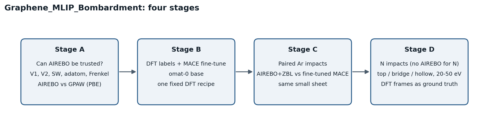

*Figure 1. The four stages of the study.*

All labels use one DFT recipe (id `8c357474ed`): GPAW, PBE, plane waves at 450 eV, k-point density 5, Fermi-Dirac smearing of 0.05 eV, spin-polarised, 20 Å cell height. Frames are only labelled when atoms are at least 1.0 Å (C-C), 1.1 Å (C-N), 1.0 Å (N-N) and 1.6 Å (Ar-C) apart, the distances at which the setup is considered reliable.

Stage D is a loop (Figure 2): run impacts with the current model, select frames spread over time and energy, remove unphysical atoms, label with DFT, fine-tune again, and test on impacts that were never in the training set. The loop was repeated five times (models n6 to n10).


*Figure 2. The label, fine-tune and test loop used for nitrogen. The sanitise step (orange) was added after DFT failures traced to magnetic free atoms; see section 5.*

Fine-tuning starts from omat-0, keeps the elements C, N and Ar, uses atomic reference energies measured with the same DFT recipe, and weights forces on the projectile more strongly. All data go into training, so the end-of-training errors only measure the fit. The generalisation evidence comes from test sets of **whole impacts** held out of training: frames from one impact are 5 fs apart and nearly identical, so splitting by frame would leak.

About 230 DFT frames are in the training databases and 37 distinct frames in three held-out test sets (Figure 3).

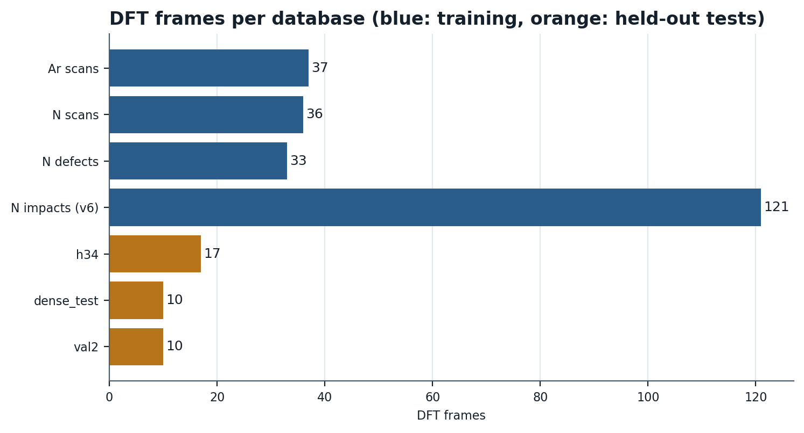

*Figure 3. DFT frames per database. Blue: training; orange: held-out tests made of whole impacts.*

## 3. Stage A: AIREBO against DFT

Formation energies of five defects in a 4×4 cell, AIREBO minus DFT:

| Defect | Error (eV) |
|---|---|
| Monovacancy V1 | −0.32 |
| Stone-Wales | +0.17 |
| Divacancy V2 | +0.67 |
| C adatom | −2.23 |
| Frenkel pair | +0.93 |

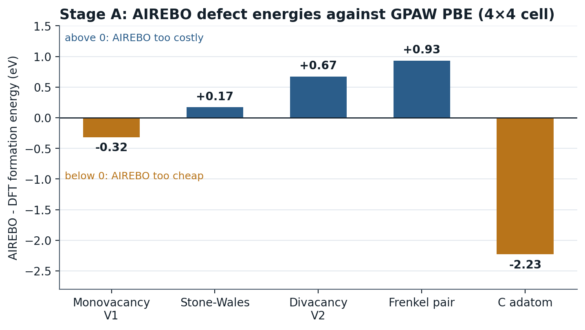

*Figure 4. AIREBO minus GPAW PBE formation energy for five defects (4×4 cell).*

The adatom error is large and holds at 5×5: AIREBO makes an adatom 2.2 eV too cheap. A plausible cause is the way bond-order potentials switch the C-C interaction off over a fixed window (about 1.7 to 2.0 Å), a known artefact of Tersoff and Brenner-type potentials (Pastewka et al., Phys. Rev. B 78, 161402, 2008). The static DFT push scan shows the same artefact as a force error at those distances. I did not remove the switching function to prove that it is the only cause.

The Stone-Wales defect is a different kind of problem. In a 5×5 cell, repeated runs with different seeds and cell heights give two AIREBO minima at 5.81 and 6.02 eV, with different out-of-plane ripples (Figure 5). DFT finds one flat structure at 5.54 eV. The cell height is not the cause. Both numbers are finite-size values and should not be quoted as the isolated Stone-Wales energy, but the comparison is fair because both methods use the same cell.


*Figure 5. AIREBO Stone-Wales formation energy in a 5×5 cell for eleven runs. The runs fall in two groups with different ripple amplitude (z spread). DFT gives 5.54 eV.*

**Conclusion of stage A.** AIREBO mis-ranks defects that differ in bonding topology, and its potential energy surface has spurious structure. A simulation that uses it will shift defect populations and thresholds, not only noise them.

## 4. Stages B and C: fine-tuning and Ar impacts

The Ar-aware fine-tuned model was trained on 68 carbon rows and 36 Ar scans. On DFT-labelled impact frames its force error is 0.42 eV/Å, against 1.11 eV/Å for AIREBO+ZBL.

In paired Ar impacts on the same sheet, the Ar vacancy threshold at the top site is below 50 eV for MACE and 50 to 55 eV for AIREBO. This follows the carbon displacement threshold: 20 to 21 eV for MACE, 25 to 26 eV for AIREBO, and about 21 eV from experiment-based estimates. A frame test on 14 DFT frames gives a force RMSE of 1.69 eV/Å for AIREBO against 0.51 eV/Å for MACE.

A binary-collision estimate puts these numbers in perspective. Head-on, Ar (40 u) can transfer at most 71 % of its energy to a carbon atom (12 u), so reaching a displacement threshold of 20.5 eV needs about 29 eV, and 25.5 eV needs about 36 eV. The ordering agrees with the MD: AIREBO needs about 25 % more. The absolute value does not: the MD threshold of 50 to 55 eV for AIREBO is about 40 % above the head-on estimate. The likely reasons are the three-fold bonding of the struck atom, impacts that are not head-on, and an Ar atom that keeps pushing while the carbon leaves. I did not separate these.

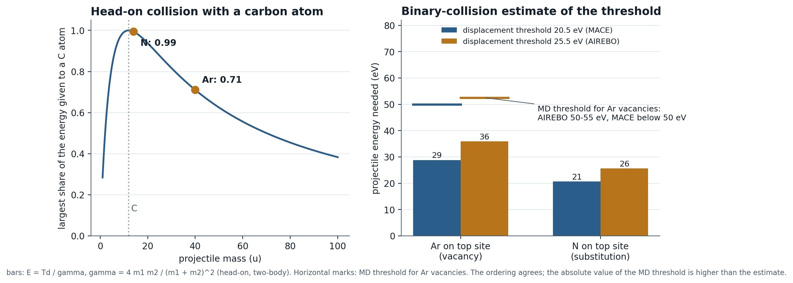

*Figure 6. Left: largest share of its energy that a projectile can give a carbon atom in a head-on collision. Right: projectile energy needed to reach a carbon displacement threshold of 20.5 eV (MACE) or 25.5 eV (AIREBO), against the Ar vacancy thresholds found in MD.*

**Conclusion of stages B and C.** The fine-tuned model is much closer to DFT on impact frames, and the shift of the threshold is explained by the displacement energy of carbon. What is *not* shown is that the MACE Ar thresholds themselves are right, because DFT frames do not go below Ar-C 1.6 Å. Any yield curve computed with AIREBO, including my own Graphene-Defect-Engineering-MD repository, should be read with a threshold that is probably 20 % too high.

## 5. Stage D: nitrogen

### 5.1 Two problems in the labels

Two problems in the data had to be fixed before any model could be trusted.

**Magnetic free atoms.** When a carbon atom is sputtered, the DFT frame contains a free atom. Free carbon is a triplet, 1.27 eV below its non-magnetic state; the calculation oscillates, lands in metastable states with ±4 µB and fails. The periodic 20 Å cell also wraps distant atoms back into the sheet. Frames are therefore sanitised: carbon atoms more than 7 Å from the sheet, or more than 2.3 Å from every other atom, are removed. The MD itself is not affected.

**An unstable N₂ reference.** Formation energies of N-containing defects are measured against N₂, a closed-shell triple-bonded molecule that looks nothing like the sheet data. With a single N₂ row in the training set, the error of the N₂ reference energy jumped between retrains, from 2.4 to 56.9 meV/atom (Figure 7). Nine DFT N₂ frames (bond 1.02 to 1.35 Å, heights 3.5 to 7 Å) reduced it to 7.5 meV/atom for n10.

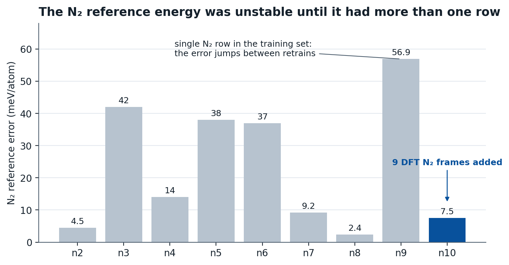

*Figure 7. Error of the N₂ reference energy across model versions. It jumps between retrains while N₂ is a single training row and settles once nine DFT frames are added.*

### 5.2 How well does the model do on unseen impacts?

Figure 8 compares the final model (n10) with DFT on the 37 held-out frames (1210 atoms). Forces on all atoms follow the diagonal over a range of ±20 eV/Å with a pooled RMSE of 0.130 eV/Å, an MAE of 0.073 eV/Å and R² = 0.996 (RMSE 0.09 to 0.15 eV/Å per set). The forces on the N atom, up to 15 eV/Å, fall on the diagonal too, with an RMSE of 0.362 eV/Å and an MAE of 0.241 eV/Å (37 N atoms, 111 components, R² = 0.995): about three times the all-atom error, on the atom that matters most. R² is 0.995 to 0.996 in both force panels only because the forces span ±15 to ±20 eV/Å, so the RMSE is the number to read. The energy panel is more informative. The mean absolute error is 4.8 meV/atom over all frames (4.3 to 5.6 meV/atom per set), with a mean bias of −3.3 meV/atom, but the errors are not random: all frames of dense_test and val2 sit about 5 meV/atom below DFT with little spread, which looks like a roughly constant shift per frame (about 0.15 eV for a frame of 33 atoms, the average of the test frames). A constant shift does not change forces or dynamics, but it does change binding and formation energies, and it is of the same order as the errors in section 5.4. The h34 set has two outliers, at −12 and −23 meV/atom; the larger is about 0.8 eV for an average-sized frame (the atom count of that frame was not checked). Atoms within a frame are not independent and the frames come from a small number of impacts (see below), so these numbers describe these 37 frames only.

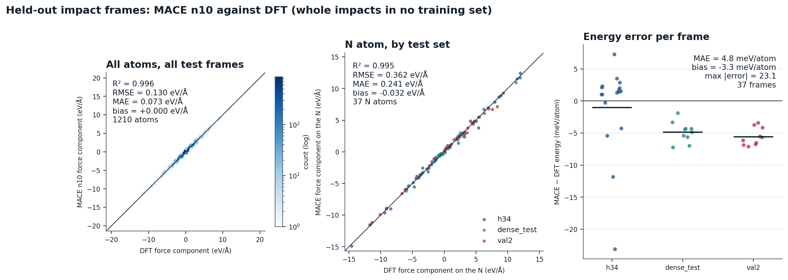

*Figure 8. Parity plots of MACE n10 against DFT on held-out impact frames. Left: force components of all 1210 atoms in the 37 frames (R² = 0.996, RMSE 0.130 eV/Å, MAE 0.073, bias 0.000). Middle: force components of the 37 N atoms, by test set (R² = 0.995, RMSE 0.362 eV/Å, MAE 0.241, bias −0.032). Right: energy error per frame (MAE 4.8 meV/atom, bias −3.3; largest error 23.1 meV/atom, in h34; bars: set means). R² is high because the force components span about ±15 eV/Å, so read the RMSE. Atoms within a frame are not independent, so the numbers describe these 37 frames only.*

**What the test frames are.** The held-out set h34 holds the labelled frames from runs 3 and 4 of every case: 17 frames from 9 distinct impacts (top site at 20, 30 and 50 eV, runs 3 and 4; bridge at 30 eV, runs 3 and 4; bridge at 50 eV, run 3 only). Runs of the same case differ in a random shift of the impact point, up to ±0.15 Å in x and y. Frames were taken from the stored MD trajectories at 30 to 280 fs into the run, at chosen delays after the closest approach, so they test the collision and the damaged sheet that follows. Before the DFT calculation, carbon atoms that had been sputtered or left isolated (more than 2.3 Å from any other atom, or more than 7 Å from the sheet plane) were removed, because free carbon atoms are magnetic in DFT and break SCF convergence, and an N further than 7 Å from the sheet was moved to 7 Å. Frames with a C-N distance below 1.1 Å or a C-C distance below 1.0 Å were not labelled. The test therefore covers the sheet without its ejected atoms, and contains no very close contacts. Thirteen of the 17 frames are top-site impacts, the site where the model extrapolates below 1.1 Å, so the h34 error is mostly a top-site error.

Figure 9 shows the force error on the N atom for the five models on the three test sets, all made of whole impacts, and on the four late frames that belong to h34.


*Figure 9. Force error on the N atom (norm/√3 convention) on held-out impact frames. Training data grow from n6 to n10.*

| Test set | n6 | n7 | n8 | n9 | n10 |
|---|---|---|---|---|---|
| h34 (17 frames) | 0.464 | 0.514 | 0.511 | 0.429 | 0.426 |
| late frames (4, inside h34) | 0.272 | 0.373 | 0.349 | 0.229 | 0.232 |
| dense_test (10, hollow) | 0.718 | 0.186 | 0.208 | 0.213 | 0.236 |
| val2 (10) | 1.080 | 0.362 | 0.346 | 0.363 | 0.349 |

h34 holds the frames of impact runs r3 and r4 (17 frames from 9 impacts, top and bridge sites). The four late frames (65 to 280 fs, top site) belong to h34; they are listed separately because they test the late, damaged-sheet stage. dense_test holds 10 hollow-site frames from 5 impacts, held out by whole impact from the dense hollow scan. val2, a second validation set, holds 10 hollow-site frames from 6 impacts at 40 and 55 eV (runs 0 to 2).

Three readings follow.

- Adding dense hollow-site frames at n7 cuts the hollow error from 0.72 to 0.19 and the val2 error from 1.08 to 0.36. This is the largest gain in the whole study, and it comes from data, not from a better model.
- n9 and n10 improve on h34 (0.43 against 0.46 to 0.51). This is the clean evidence of progress between n8 and n10.
- On near-contact top and bridge frames, all models stay at 0.4 to 0.5 eV/Å. Between 0.15 and 0.3 eV/Å of that is the difference between spin-polarised and unpolarised DFT labels, which a model that does not see spin cannot resolve.

**A data leak, found and corrected.** The original `late_test` set had nine frames. The script that created the h34 split also read that database as a source, so five of its frames ended up in the training data of n9 and n10. Their `late_test` errors (0.163 and 0.165 eV/Å) were therefore not held-out numbers. The corrected set `late_clean` keeps the four frames that are in no training set. There, n9 and n10 give 0.23 eV/Å against 0.27 to 0.37 for n6 to n8, a gain that is real against n7 and n8 but within noise against n6. These four frames are also part of h34 (they are its late-time frames), so they are not a separate set and the pooled statistics count them once: 37 distinct held-out frames, not 41. h34, dense_test and val2 have no overlap with any training set (checked frame by frame against the Ar scan, N scan, N defect and N impact (v6) databases).

**Where the error is.** Figure 10 plots the error of each held-out frame against its shortest N-C distance. The shortest distance in any held-out frame is 1.18 Å, because DFT frames closer than 1.1 Å were never labelled, and Figure 11 shows the same for the training data: no label below 1.1 Å, most between 1.2 and 1.5 Å. The tests therefore say nothing about the region below 1.1 Å. Inside the range that is tested the error does not rise towards short distance. The four largest errors (0.64 to 1.01 eV/Å) are at 1.38 to 1.48 Å, and three of the four late frames, at 1.18 to 1.25 Å, are at 0.26 to 0.27 eV/Å. Figure 14 shows the four frames with the largest errors next to the two frames with the smallest errors at similar N-C distances (up to 1.45 Å). In the four worst frames the sheet is disrupted around the N (broken rings, a carbon pulled out of its ring position, in one case a missing carbon with another displaced below the sheet) and the N sits out of the sheet plane; in the two quiet frames, at 1.23 and 1.28 Å, the sheet is intact and flat and the N is in the plane. At similar distances, then, the error follows the damage to the sheet and the position of the N, not the distance. Six frames, chosen as the extremes, show this as an association, not a measured relation. My reading is that the disrupted frames contain under-coordinated carbon with radical character, where the spin ambiguity described under the limitations applies; this is an inference and was not tested.

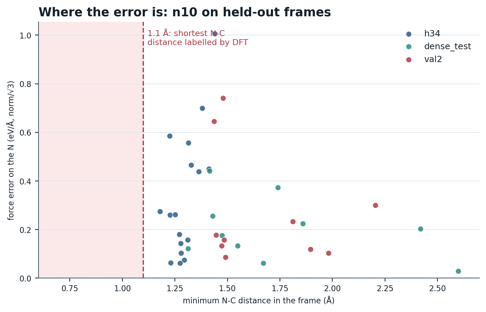

*Figure 10. Force error on the N atom against the shortest N-C distance, for each held-out frame. The shaded region is below the shortest distance labelled by DFT.*

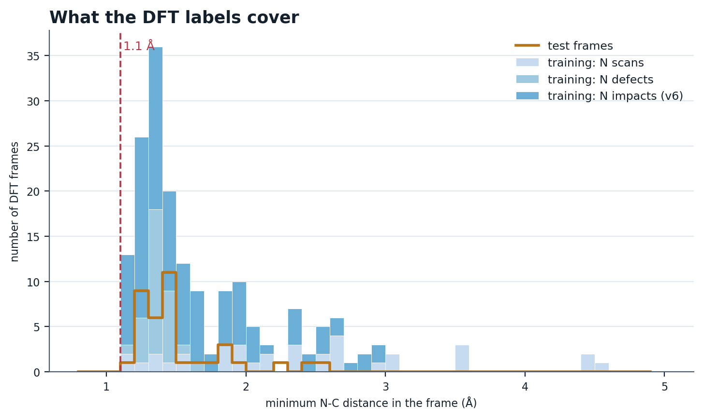

*Figure 11. Shortest N-C distance of the DFT frames (training, stacked; test frames, line). Nothing lies below 1.1 Å.*

### 5.3 What happens in an impact

The three impact sites are the top of a carbon atom, the middle of a C-C bond (bridge) and the centre of a hexagon (hollow). Figure 12 shows them with the closest N-C approach reached in each case, to compare with the 1.1 Å limit of the DFT labels.

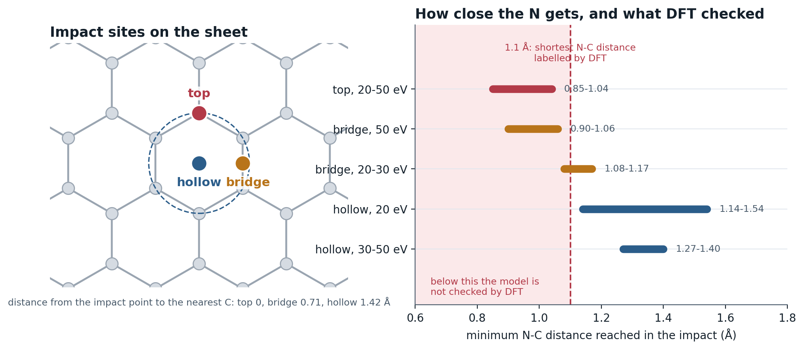

*Figure 12. Left: the three impact sites on the lattice. Right: range of the shortest N-C distance reached in the MD impacts, against the 1.1 Å limit (shaded: not labelled by DFT).*

Figure 13 shows the outcome of five impacts per case with the final model, for three impact sites and three energies.

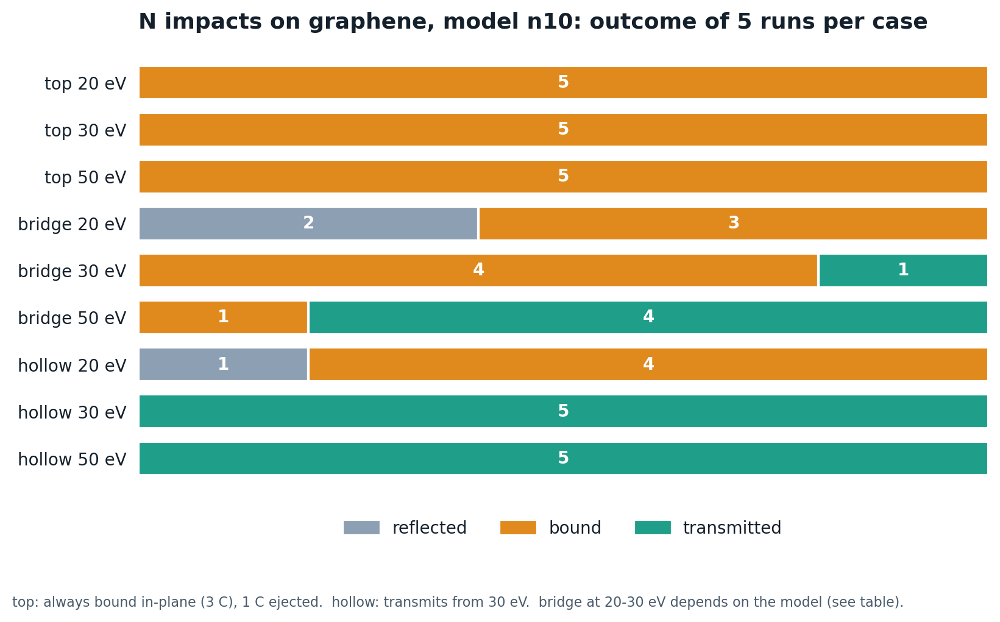

*Figure 13. Outcome of five N impacts per case with n10: bound in the sheet, transmitted through it, or reflected.*

- **Top site (20, 30 and 50 eV): N always ends up in the lattice with three carbon neighbours, and the struck carbon atom is ejected.** All five models agree. A head-on N (14 u) passes about 99 % of its energy to C (12 u), so at 20 eV it is just at the MACE displacement threshold of 20 to 21 eV. The attraction between N and C (the N gains its chemisorption energy before contact, and forms a new bond as the carbon leaves) makes the exit cheaper than for a bare carbon recoil. This is substitutional doping by knock-on, and the displacement threshold of carbon is not the threshold for N substitution.
- **Hollow site: transmitted at 30 and 50 eV, mostly bound at 20 eV.** The effective barrier for pushing N through the ring is therefore between 20 and 30 eV. No carbon atom is ejected. This is the best-validated channel, because the minimum N-C distance (1.14 to 1.54 Å at 20 eV, 1.27 to 1.40 Å above) stays inside the DFT-labelled region.
- **Bridge site: depends on the energy and the model.** At 50 eV most impacts (4 of 5 with n10) are transmitted. At 30 eV a bound state is the majority. At 20 eV the outcome depends on the model: n6 and n10 give mostly bound, n7 and n8 mostly reflected. These cases sit where the kinetic energy is close to the barrier, and a force error of 0.4 to 0.5 eV/Å over about 0.3 Å is 0.1 to 0.15 eV, about the size of the margin. The model dependence reflects a small energy margin, not chaos, and it means no probability can be quoted.

Figure 14 shows what the labelled frames of such impacts look like. The four frames with the largest force errors are on the left and the two frames with the smallest errors at similar N-C distances are on the right: the large errors go with a disrupted sheet and an N out of the plane, the small ones with an intact flat sheet and the N in the plane.

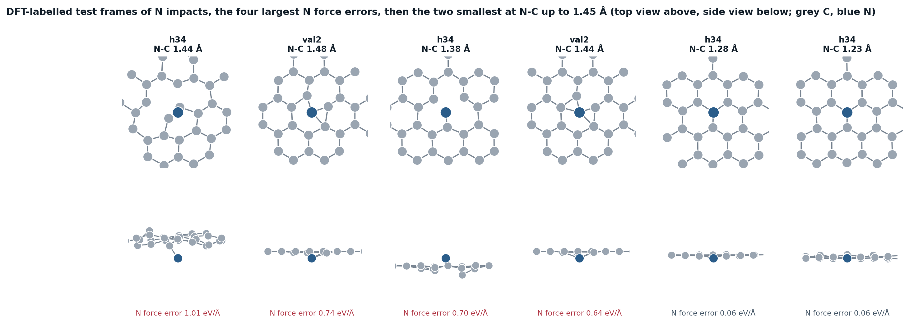

*Figure 14. Held-out DFT frames of N impacts: the four largest N force errors (left) and the two smallest at N-C distances up to 1.45 Å (right), with the test set and the shortest N-C distance above each frame (top view above, side view below; grey C, blue N). The red labels mark force errors above 0.4 eV/Å.*

### 5.4 Chemistry of N in the sheet

The model is good at impacts and poor at ranking N configurations.

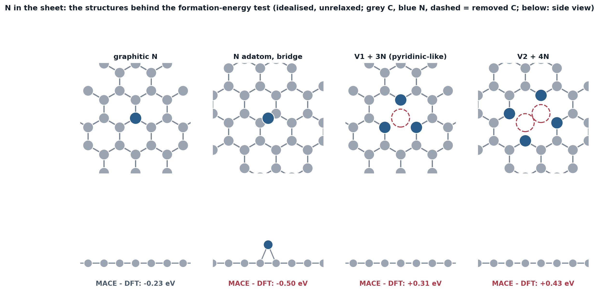

*Figure 15. The structures behind the formation-energy test (idealised, unrelaxed schematics; dashed circles: removed carbon atoms) with the MACE minus DFT error of each.*
 Formation-energy errors against DFT (MACE minus DFT, unrelaxed structures, eV): N adatom at a bridge site −0.50, at a top site −0.27, graphitic N −0.23, V1+1N −0.23, V1+2N +0.15, V1+3N +0.31, V2+2N −0.26, V2+4N +0.43. The sign changes between structures, so no single offset fixes them, and in DFT the relative energies of graphitic N, pyridinic N and adatoms are within about 1 eV, so errors of 0.2 to 0.5 eV can reorder them. These are errors on structures that are in the training set, because training used all data, which points to underfitting or conflicting labels, not to extrapolation. Spin is a candidate (vacancies and adatoms are magnetic, graphitic N is not), but I did not test it. **The model should not be used to rank N configurations thermodynamically.**

## 6. What this study does not show

- **The most useful channel is the least validated.** Top-site impacts, which produce graphitic N, pass through N-C distances of 0.85 to 1.04 Å, below the 1.1 Å limit for DFT frames. Figures 10 and 11 make this sharper: there is no label below 1.1 Å in the training data either, so the model is extrapolating there, not just unchecked. The 1.1 Å limit is a practical choice: the plane-wave cutoff and the PAW datasets were not designed for these distances, and it has not been checked with a harder setup or an all-electron code.
- **The committee is not independent.** Models n6 to n10 share the base model, the architecture and heavily overlapping data. Their agreement on the top and hollow outcomes shows stability against retraining, not agreement between independent methods.
- **One adiabatic surface.** The dynamics follow a neutral, single-spin-state potential energy surface. A real collision can change spin surface, and a real beam is charged and neutralised close to the sheet. At 20 to 50 eV nuclear stopping dominates, but nothing here tests the rest.
- **Sampling.** One incidence angle, three high-symmetry impact points, five runs per case. A cross-section needs the full impact-parameter map and thermal sampling. The sheet is free-standing, so there is no substrate.
- **Time window.** Outcomes are classified at the end of a short run. Diffusion of adatoms, reconstruction of vacancies and recombination of ejected atoms are not covered.
- **The MD sheet is strained.** It was built with a lattice constant of 2.46 Å and not relaxed with AIREBO (about 1.7 % strain compared to the AIREBO value near 2.42 Å). I did not measure the effect on the thresholds.

## 7. What would settle the open points

In order of value for effort:

1. DFT frames below 1.1 Å with a harder PAW setup or an all-electron code, to find the real validity limit and label the top-site channel.
2. An independent uncertainty estimate: a second foundation model or different seeds, compared on the same impacts.
3. A spin-resolved check of the ejection channel: the same frames with fixed total moments.
4. An impact-parameter map for N with thermal sampling, to turn channels into cross-sections.
5. A test without the AIREBO switching function (or with a screened variant), to see whether the stage A errors and the threshold shift disappear.
6. A comparison of thresholds and yields with published ion-irradiation MD of graphene (for example Lehtinen et al., Phys. Rev. B 81, 153401, 2010) and with experiment. Measured and DFT-MD displacement thresholds depend on temperature and on the definition of "displaced" (see arXiv:1811.04011), so agreement within a couple of eV is the realistic target.

## Repository layout

```
stageA_dft_check/       AIREBO against DFT defect energies, result tables (CSV)
stageB_mace_training/   fine-tuning, DFT labelling workflow, impact tests, stage notes
  STAGE_A..D_*.md       detailed result notes with all numbers
  data/**/labelled*.db  DFT-labelled ASE databases (training and test frames)
figures/                the figures and the script that makes them (make_figs.py)
```

Not included: model weights, trajectories, logs and the AIREBO potential file. The fine-tuned model is built on MACE omat-0; check the licence of the base model before redistributing weights.

Tools: GPAW, ASE, LAMMPS (AIREBO, ZBL), MACE, Python.

## Licence and author

MIT, see `LICENSE`.

Safouan Ziat, Ph.D. · GitHub: safouanziat
