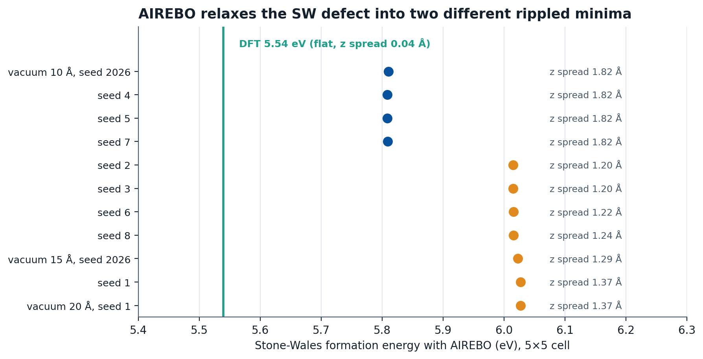

# Graphene_MLIP_Bombardment

Can a fine-tuned machine-learning interatomic potential (MACE) replace AIREBO for ion bombardment of graphene, with DFT as the ground truth?

This repository holds the scripts, the DFT-labelled databases and the result notes of that study. It is a work in progress: stages A to D are done, the limits are listed openly at the end.


## Why

Ion irradiation of graphene (vacancies, doping with N) is usually simulated with classical potentials such as AIREBO. They are fast, but they were fitted near equilibrium. Impacts probe short distances, bond breaking and unusual coordination, which is where classical potentials are least trustworthy. A foundation MLIP fine-tuned on a few hundred DFT frames can be checked against DFT directly. The question is where it helps and where it still fails.

## The four stages

| Stage | Question | Result |
|---|---|---|
| A | Can AIREBO be trusted for defects? | Formation energies of V1, V2, Stone-Wales, adatom and Frenkel pair against GPAW PBE |
| B | Can MACE omat-0 be fine-tuned to DFT labels for C and Ar? | Force error on impact frames 0.42 eV/Å (MACE) against 1.11 eV/Å (AIREBO+ZBL) |
| C | Do paired Ar impacts differ between the two potentials? | Yes: different vacancy thresholds, traced to the C displacement threshold |
| D | Can the model handle N, for which AIREBO has no parameters here? | Tested against DFT on held-out whole impacts; committee of 5 runs per case |

### Stage A: AIREBO against DFT (4×4 cell, eV)

| Defect | AIREBO − DFT |
|---|---|
| Monovacancy V1 | −0.32 |
| Stone-Wales | +0.17 |
| Divacancy V2 | +0.67 |
| C adatom | −2.23 |
| Frenkel pair | +0.93 |

The adatom error holds at 5×5. Stone-Wales in a 5×5 cell shows that AIREBO has two rippled minima (5.81 and 6.02 eV, against 5.54 eV in DFT, which is flat). Repeated seeds and cell heights give the same two values, so the difference is not a cell-size effect.



### Stage B: fine-tuning

- DFT recipe `8c357474ed`: GPAW, PBE, plane waves 450 eV, k-density 5, Fermi-Dirac smearing 0.05 eV, spin-polarised, cell height 20 Å.
- Base model MACE omat-0, fine-tuned on 68 carbon rows and 36 Ar scans, keeping the Ar element.
- Force error on impact frames against DFT: 0.417 eV/Å for the Ar-aware MACE model, 1.107 eV/Å for AIREBO+ZBL.

### Stage C: paired Ar impacts

Same small sheet, same impacts, AIREBO+ZBL against fine-tuned MACE.

- Ar vacancy threshold at the top site: MACE below 50 eV, AIREBO 50 to 55 eV.
- The gap follows the carbon displacement threshold: AIREBO 25 to 26 eV, MACE 20 to 21 eV (experiment-based value about 21 eV).
- A static DFT push scan shows an AIREBO C-C cutoff artefact.
- Frame test (14 DFT frames): force RMSE 1.69 eV/Å (AIREBO) against 0.51 eV/Å (MACE).
- Not proven: the MACE Ar thresholds themselves, because DFT frames do not go below Ar-C 1.6 Å.

### Stage D: nitrogen

AIREBO has no N parameters in this setup, so DFT is the only independent check. The work is an iterative loop: run impacts, label selected frames with DFT, retrain, test on whole impacts that were never in the training set.


Force error on the N atom (eV/Å) on held-out whole impacts:

| Test set | n6 | n7 | n8 | n9 | n10 |
|---|---|---|---|---|---|
| h34 (17 frames) | 0.464 | 0.514 | 0.511 | 0.429 | 0.426 |
| late_test (9) | 0.220 | 0.269 | 0.248 | 0.163 | 0.165 |
| dense_test (10, hollow) | 0.718 | 0.186 | 0.208 | 0.213 | 0.236 |
| val2 (10) | 1.080 | 0.362 | 0.346 | 0.363 | 0.349 |


Outcome of 5 impacts per case with the final model (n10):


- Top site, 20 to 50 eV: N is always bound in-plane, one C atom is ejected. Same in all five models.
- Hollow site, 30 and 50 eV: N is always transmitted. Same in all five models.
- Bridge site, 50 eV: mostly transmitted.
- Bridge site, 20 eV: depends on the model (bound in n6 and n10, reflected in n7 and n8). No probability is quoted.

### Problems found and fixed along the way

- **Magnetic free carbon atoms.** A sputtered C atom in a DFT frame is a free magnetic atom. It makes the SCF oscillate, gives metastable ±4 µB states and failed jobs. Frames are now sanitised: C atoms farther than 7 Å from the sheet, or more than 2.3 Å from every other atom, are removed before labelling.
- **Unstable N₂ reference energy.** With one N₂ row in the training set, the reference energy jumped between retrains. Nine DFT N₂ frames fixed it.


## Critical analysis: what the results mean physically, and what they do not

Each statement is tagged **measured** (a number in this repository), **inferred** (follows from measured numbers plus standard physics, not tested here) or **untested** (a hypothesis). Where a claim rests on the notes only, the table or figure above is the evidence.

### 1. Why AIREBO fails where it fails

- **Over-stabilised adatoms and interstitial-like defects (measured).** The adatom formation energy is 2.23 eV too low and the Frenkel pair 0.93 eV too high in the AIREBO − DFT convention, while V2 is 0.67 eV too high. Errors of this size are not a fitting detail: they say that AIREBO mis-ranks defects that differ in bonding topology (sp³-like adatom bonds against dangling bonds at vacancies).
- **Likely cause (inferred).** Bond-order potentials switch the C-C interaction off over a fixed distance window (about 1.7 to 2.0 Å in AIREBO). A displaced atom that sits in that window feels a switching-function artefact instead of a real bond. This is the known cutoff problem of Tersoff/Brenner-type potentials (Pastewka et al., Phys. Rev. B 78, 161402, 2008, to be checked against the AIREBO case). The static DFT push scan shows the same artefact as a force error at those distances. I have not removed the switching function to prove it is the sole cause.
- **Two rippled Stone-Wales minima (measured).** DFT has one flat structure at 5.54 eV in a 5×5 cell. A 5×5 cell is small, so 5.54 eV is a finite-size value, not the isolated-defect energy; the comparison is fair because both methods use the same cell, but neither number should be quoted as *the* Stone-Wales energy.
- **Consequence for published AIREBO results (inferred).** If a potential makes displacement harder (see 2) and adatoms too stable, yield curves and defect populations computed with it are shifted in energy and in defect type. This includes the Ar yield curves of my Graphene-Defect-Engineering-MD repository, which should be read with a threshold shift of about 20 %.

### 2. Displacement threshold: a simple check on the Ar result

For a head-on elastic collision the largest energy a projectile of mass *m₁* can give a carbon atom is γ·E, with γ = 4 m₁ m₂ / (m₁ + m₂)².

| Projectile | γ (to C) | Energy for 20.5 eV on C (MACE) | Energy for 25.5 eV on C (AIREBO) |
|---|---|---|---|
| Ar | 0.71 | about 29 eV | about 36 eV |
| N | 0.99 | about 21 eV | about 26 eV |

- **The ordering agrees (inferred).** AIREBO needs a larger kick than MACE, and the gap of about 25 % between the two displacement thresholds is the gap seen between the Ar vacancy thresholds (50 to 55 eV against below 50 eV). This supports the explanation of Stage C: the Ar threshold difference comes from the C displacement threshold, not from the Ar-C repulsion.
- **The absolute values do not agree (measured against inferred).** The head-on estimate gives about 36 eV for AIREBO, but the MD vacancy threshold is 50 to 55 eV. A head-on, instantaneous, two-body collision underestimates the threshold by roughly 40 %. The likely reasons are that the struck atom is bonded to three neighbours (a larger effective mass), that impacts are not head-on, and that the Ar keeps pushing while the C leaves. I have not separated these contributions.
- **Experiment is not a clean benchmark (inferred).** Measured and DFT-MD displacement thresholds for graphene cluster around 21 to 23 eV, but they depend on temperature, direction and the definition of "displaced" (see for example the temperature study at arXiv:1811.04011). A match of MACE (20 to 21 eV) with experiment is encouraging, not proof.

### 3. Nitrogen: what the three sites actually test

- **Top site: replacement collision (inferred).** N (14 u) is nearly the same mass as C (12 u), so it passes about 99 % of its energy head-on. At 20 eV that is just at the MACE displacement threshold, yet the C atom is ejected in all runs and N ends up with 3 C neighbours. The extra energy comes from the attraction: the N gains the chemisorption energy before contact, and the N-C bond that forms as the C leaves makes the exit cheaper than for a bare C recoil. This is chemistry, not a purely kinematic effect, and it means the displacement threshold of C is not the threshold for N substitution.
- **Top site is the least validated channel (measured).** It runs through N-C distances of 0.85 to 1.04 Å, below the 1.1 Å DFT-trusted limit. The channel that produces graphitic N, the product people want, is the one that DFT never checked.
- **Hollow site: the best-validated channel (measured).** The minimum N-C distance is 1.14 to 1.54 Å, inside the labelled region, and the hollow test error is 0.19 to 0.24 eV/Å. The outcome changes between 20 eV (mostly bound) and 30 eV (always transmitted): the effective barrier for pushing N through the hexagon is therefore between 20 and 30 eV. This is the most solid physical statement of Stage D, but it only says that the sheet is transparent to 30 eV N at the ring centre, not that real irradiation of graphene transmits most ions.
- **Bridge site at 20 to 30 eV: marginal cases (inferred).** The outcome flips between models where the kinetic energy is close to the barrier. A force error of 0.4 to 0.5 eV/Å over about 0.3 Å is 0.1 to 0.15 eV, small compared with the beam energy but of the order of the margin that decides a marginal case. Model dependence there reflects a small energy margin, not chaotic failure, and it does not mean the physics is unknowable. It does mean that no probability can be quoted.
- **The committee is not independent (inferred).** n6 to n10 share the same base model, the same architecture and heavily overlapping data. Their agreement on top and hollow shows stability against retraining, not agreement between independent methods. A real uncertainty estimate needs different seeds, a different base model, or a different method.

### 4. Chemistry of N in the sheet

- **Formation energies are off in a systematic direction (measured).** MACE − DFT is −0.50 eV (N adatom, bridge), −0.27 (adatom, top), −0.23 (graphitic N), −0.23 (V1+1N), +0.15, +0.31 (V1+2N, V1+3N) and −0.26 and +0.43 (V2+2N, V2+4N). The sign changes between structures, so a single offset would not fix them. The relative energies of graphitic, pyridinic and adatom N are typically within about 1 eV in DFT, so an error of 0.2 to 0.5 eV can reorder them. **Do not use this model to rank N configurations thermodynamically.**
- **Not a held-out error (measured).** Training used all data (validation rows are copies), so these are errors on structures the model was fitted to. Large errors on training structures point to underfitting or conflicting labels, not to extrapolation. Spin is a candidate (V1 and adatoms are magnetic, graphitic N is not) but I did not test it.
- **Pyridinic N (untested).** Multi-N vacancy structures are where the model is worst. Pyridinic N has an in-plane lone pair and a reconstructed vacancy; both are electronic effects that a short-range local model can fit only if the training set contains enough examples. It probably does not.
- **The N₂ reference (measured, with a physical reason inferred).** A closed-shell triple-bonded molecule in vacuum is a bonding environment unlike anything in the sheet data. With one row in the training set, the model extrapolates to it, and the error moved between 2.4 and 56.9 meV/atom from one retrain to the next. At 56.9 meV/atom the reference shifts a formation energy by 0.06 eV per N atom, or 0.23 eV for V2+4N, the same size as the other errors. 7.5 meV/atom (n10) removes this contribution but not the structural errors above.

### 5. Limits of the physics model itself

- **Spin (measured floor).** Spin-polarised and unpolarised labels differ by 0.25 to 0.5 eV/Å near contact. The MLIP learns one of the two branches; a real collision can end on a different spin surface. Free C (triplet) and N (quartet) atoms make this relevant exactly in the ejection channels.
- **Born-Oppenheimer and charge (untested).** The dynamics follow a single adiabatic, neutral surface. At 20 to 50 eV nuclear stopping dominates and electronic excitation is small, but real ion beams are charged and neutralised close to the surface. Nothing here tests that, and for a reactive ion like N it could matter near the threshold.
- **DFT as the reference (untested).** PBE, the 450 eV plane-wave cutoff and the PAW datasets were not designed for N-C distances below 1.1 Å; the 1.1 Å limit is a practical choice and has not been verified with a harder setup or an all-electron code. PBE also overbinds N₂ by about 0.5 eV per molecule; this cancels in a MACE-against-DFT comparison but not against experiment.
- **Geometry and sampling (inferred).** One incidence angle, three high-symmetry impact points, five runs per case. A cross-section needs the full impact-parameter map and thermal sampling. The sheet is free-standing: a substrate adds backscattering, a heat sink and charge transfer.
- **Time window (inferred).** Outcomes are classified at the end of a short run. Adatom diffusion, vacancy reconstruction and recombination of ejected atoms over longer times are not covered.

### 6. Tests that would settle the open points

In order of value for effort:
1. DFT frames below 1.1 Å with a harder PAW setup or an all-electron code, to find the real validity limit and to label the top-site channel.
2. An independent uncertainty estimate: a second foundation model or different seeds, compared on the same impacts.
3. Spin-resolved check of the ejection channel: run the same frames with fixed total moments and compare forces.
4. Impact-parameter map for N with thermal sampling, to turn channels into cross-sections.
5. Remove the AIREBO switching function (or use a screened variant) to see whether the Stage A errors and the threshold shift disappear.
6. Compare thresholds and yields with published ion-irradiation MD of graphene (for example Lehtinen et al., Phys. Rev. B 81, 153401, 2010) and with experiment.

## Limitations

1. Top-site and 50 eV bridge impacts pass through N-C distances below 1.1 Å, the shortest distance labelled by DFT. Forces there are not verified.
2. Labels are spin-polarised and the model does not see spin. This leaves an error of 0.25 to 0.5 eV/Å on near-contact frames, whatever the model.
3. Five runs per case, one set of seeds: outcomes are not probabilities.
4. Formation energies of structures with several N atoms are off by 0.3 to 0.4 eV. Single-N values are within about 0.5 eV (unrelaxed structures).
5. There is no AIREBO comparison for N.
6. The MD sheet was built with a 2.46 Å lattice constant and was not relaxed with AIREBO (about 1.7 % strain compared to the AIREBO value near 2.42 Å). Its effect on the thresholds has not been measured.

## Repository layout

```
stageA_dft_check/       AIREBO against DFT defect energies, result tables (CSV)
stageB_mace_training/   fine-tuning, DFT labelling workflow, impact tests, stage notes
  STAGE_A..D_*.md       detailed result notes
  data/**/labelled*.db  DFT-labelled ASE databases (training and test frames)
figures/                figures and the script that makes them (make_figs.py)
```

The notes `STAGE_A_RESULTS.md` to `STAGE_D_RESULTS.md` hold the full numbers and the reasoning.

## Not included

Model weights, trajectories, logs and the AIREBO potential file are not part of the repository. The fine-tuned model is built on MACE-MP omat-0; check the licence of the base model before redistributing weights.

## Tools

GPAW, ASE, LAMMPS (AIREBO, ZBL), MACE, Python.

## Licence

MIT, see `LICENSE`.

## Author

Safouan Ziat, Ph.D. (GitHub: safouanziat)
